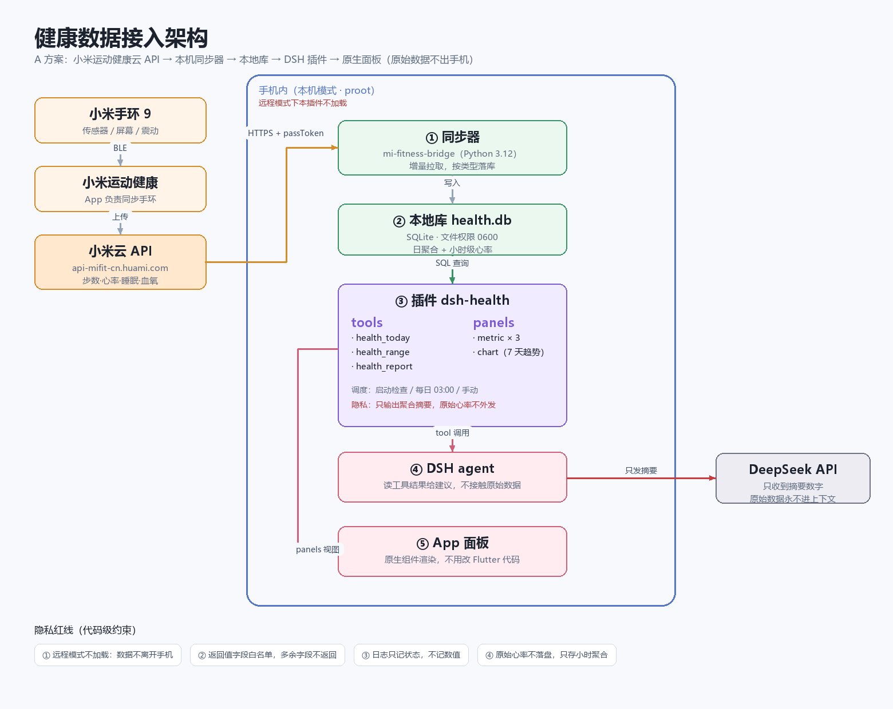

# 健康数据接入（A 方案：小米云 API）

## 一句话

小米运动健康把手环数据同步到小米云；本机模式下的同步器把云数据拉进本地 SQLite；
DSH 插件读库、算聚合、注册工具和面板；**原始数据不出手机，只有摘要进模型**。

## 五个环节

| # | 环节 | 位置 | 说明 |
|---|---|---|---|
| ① | 同步器 | 手机 proot | `mi-fitness-bridge`（Python），用 `passToken` 增量拉取 |
| ② | 本地库 | 手机 | `health.db`（SQLite，0600），日聚合 + 小时级心率 |
| ③ | 插件 | 手机引擎 | `dsh-health`：工具 + 面板 + 调度 |
| ④ | DSH agent | 手机引擎 | 读工具结果给建议，不接触原始数据 |
| ⑤ | 面板 | App | 原生组件渲染插件 JSON，不用改 Flutter |

## 为什么不用 Health Connect

小米国行（无 GMS）通常没有 Health Connect 模块；而小米运动健康的数据本来就在云端，
走云 API 既不依赖系统组件，也不需要改 App 的权限体系。

## 隐私约束（代码级）

1. 远程模式不加载插件：数据不离开手机
2. 工具返回值走字段白名单，多余字段不返回
3. 日志只记状态码，不记数值
4. 原始心率不落盘，只存小时聚合
5. `user_id` / `passToken` 永不进会话上下文，存本地 0600 或密钥环

## 前置条件

1. 能拿到 Mi Fitness 的 `user_id` + `passToken`（抓包或 root 提取）
2. 手机 proot 里能 `pip install`（有网），否则把依赖预装进运行环境镜像

## 里程碑

| 阶段 | 内容 | 估算 |
|---|---|---|
| M1 | 同步脚本跑通，拿到一天数据 | 0.5–1 天 |
| M2 | 插件入口 + `health_today` | 0.5 天 |
| M3 | 面板（metric ×3 + chart） | 0.5 天 |
| M4 | 调度、失败处理、隐私校验 | 0.5 天 |
